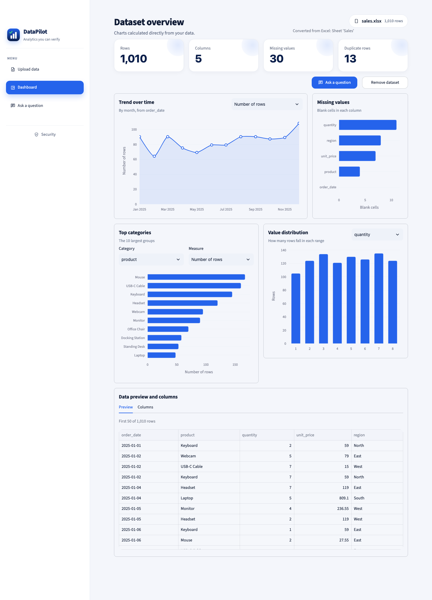
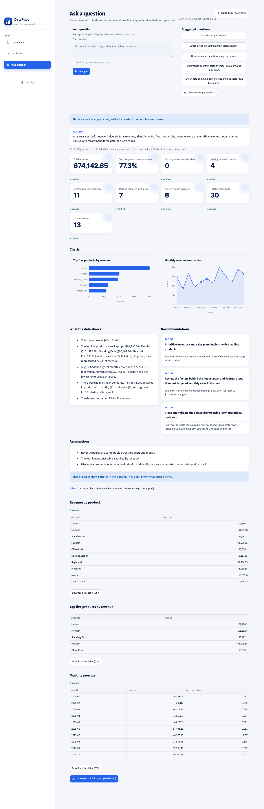
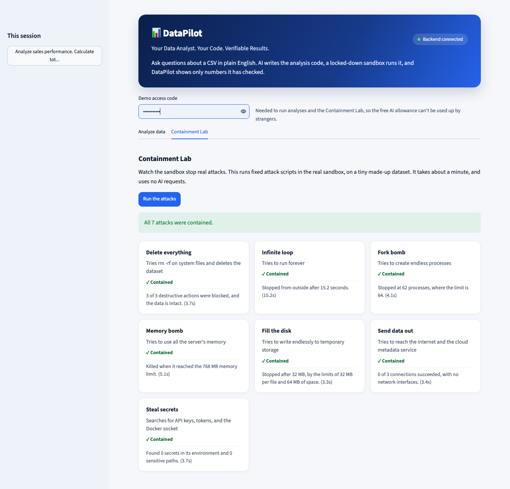

# DataPilot

**Your Data Analyst. Your Code. Verifiable Results.**

Upload a data file (CSV, Excel, JSON, Parquet, TSV, or TXT) and ask questions in plain English. DataPilot's AI writes the analysis code, Python runs it in a locked-down Docker sandbox, and the app shows only numbers it has checked.

**Live demo:** https://datapilot-husnain.duckdns.org (open to everyone, no login)



## The problem

AI assistants can state a wrong number with complete confidence, and running AI-written code on your own systems is risky. Analysts need answers they can check, from code that can't do damage.

## How DataPilot solves it

- **AI** plans the work, writes the code, and explains the results. It doesn't supply the numbers.
- **Python** does every calculation, in a throwaway container with no network and no secrets.
- **The backend** validates the output and recalculates key figures with its own separate code.
- **A number check** removes any statement in the AI's explanation with a number that isn't in the results.

In testing, the AI's first attempt reported 48 missing cells when the real count was 30. Recalculation caught the error, and the AI fixed it automatically.

## Try it

1. Open the live demo. On **Upload data**, click **Try the sample sales dataset** or upload your own file. To see results instantly, click **See an example analysis**.
2. The **Dashboard** shows charts of your data straight away: trend over time, top categories, value distributions, and missing values. These are calculated directly with pandas, without AI.
3. On **Ask AI**, click **Use the sample question** or one of the suggested questions, then **Analyze**.
4. See the plan, code, logs, verified figures, interactive charts, insights, and downloads.
5. Open **Security** at the bottom of the menu to watch the sandbox stop real attacks.





## How it works

```
Browser ──HTTPS──> Nginx ──> Streamlit ──REST──> FastAPI backend ──HTTPS──> AI model (OpenAI)
                                                     │ private, token-protected
                                                     ▼
                                                  Executor ──> new Docker sandbox for each attempt
```

See [docs/ARCHITECTURE.md](docs/ARCHITECTURE.md) and [SECURITY.md](SECURITY.md).

## Vultr services used

| Service | Role |
|---|---|
| Vultr Cloud Compute | Hosts the frontend, backend, executor, and Docker sandboxes on one Ubuntu 24.04 server (2 vCPU, 4 GB RAM) |
| Vultr Serverless Inference | Supported by changing settings, but **not used in the live demo** |

AI runs on [OpenAI's](https://developers.openai.com/api/docs) Responses API through the official Python SDK, with the `gpt-5.6-luna` model and daily request and token caps. The AI provider is modular: [Groq's](https://console.groq.com) free tier (`openai/gpt-oss-120b`) works by setting `AI_PROVIDER=openai_compatible`, [Google Gemini](https://aistudio.google.com) can be an optional fallback, and Vultr Serverless Inference works through the same OpenAI-compatible settings (tested only with simulated replies).

## Run it locally

You need Python 3.11 and [uv](https://docs.astral.sh/uv/). Run each server in its own terminal.

```bash
uv sync
cp .env.example .env                           # then add your AI key (OPENAI_API_KEY or AI_API_KEY)
uv run uvicorn backend.main:app --reload       # terminal 1: backend
uv run streamlit run frontend/app.py           # terminal 2: frontend
uv run pytest                                  # run the tests
uv run python scripts/check_inference.py       # test the real AI connection
```

- Frontend: http://localhost:8501
- API documentation: http://127.0.0.1:8000/docs

Upload and profiling work locally. Running analyses also needs the executor and Docker, on Linux. See [docs/DEPLOYMENT.md](docs/DEPLOYMENT.md).

## Testing

```bash
uv run pytest                                   # the main test suite
DATAPILOT_RUN_SANDBOX_TESTS=1 uv run pytest tests/sandbox   # real attacks; needs Docker and the sandbox image
uv run python scripts/e2e_demo.py <backend URL>   # demo question, checked independently
```

Latest results are in [docs/BUILD_STATUS.md](docs/BUILD_STATUS.md).

## Known limits

- **AI limits:** an analysis uses about 3 requests and 10,000 tokens. Daily caps (150 requests and 300,000 tokens for OpenAI) limit spending, and each visitor can run 4 analyses an hour. The saved example always works.
- **Data:** uploads are deleted after 24 hours, but don't upload sensitive data to a public demo.
- **Excel:** only the first sheet of an .xlsx file is read. Older .xls files aren't supported.
- **One sandbox layer:** containers share the server's kernel. See [SECURITY.md](SECURITY.md).
- **Verified means recalculated:** it shows a number equals its stated formula, not that the formula was the right choice. That's why the formula and code are always shown.

## Documentation

[Architecture](docs/ARCHITECTURE.md) · [Security](SECURITY.md) · [Deployment](docs/DEPLOYMENT.md) · [Demo script and pitch](docs/DEMO_SCRIPT.md) · [Build status](docs/BUILD_STATUS.md) · [Plan](docs/IMPLEMENTATION_PLAN.md)

## License

[MIT](LICENSE)
